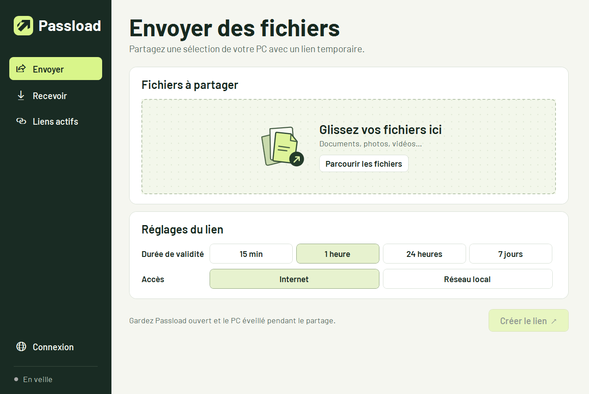

# Passload

Partagez un ou plusieurs fichiers depuis un PC Windows avec un lien temporaire. Le destinataire ouvre le lien dans son navigateur et télécharge un fichier ou toute la sélection en ZIP. Le PC expéditeur garde les originaux.

**[Télécharger Passload pour Windows x64](https://github.com/mertioz/passload/releases/latest/download/Passload.exe)** · [Versions et empreintes SHA-256](https://github.com/mertioz/passload/releases)



## Envoyer

1. Lancez `Passload.exe`. Déposez les fichiers dans la fenêtre ou choisissez **Parcourir les fichiers**.
2. Choisissez une durée, puis **Créer le lien**. Envoyez le lien copié à votre destinataire. Il contient la clé d’accès après le signe `#`.
3. Gardez Passload ouvert, le PC éveillé et les fichiers à leur emplacement jusqu’à la fin du téléchargement.

**Liens → Ouvrir ici** ouvre un aperçu sur le PC expéditeur. **Arrêter le partage** interrompt les transferts et désactive le lien. L’expiration ou la fermeture de Passload met également fin au partage.

## Recevoir

Ouvrez le lien complet dans un navigateur récent. Les boutons permettent de choisir un fichier ou **Tout télécharger en ZIP**. Le navigateur indique si la connexion est directe ou utilise le relais chiffré.

Vous pouvez aussi coller le lien dans **Recevoir** sur un deuxième PC Windows. L’application ouvre alors sa copie locale de la page de réception dans le navigateur. Le ZIP est construit au fil de l’envoi. Les fichiers homonymes conservent des entrées distinctes.

Pour les fichiers volumineux, le navigateur peut utiliser un fichier temporaire sur le disque du destinataire avant de proposer la copie terminée. Le bouton **Enregistrer à nouveau** permet de relancer l’enregistrement local. Les fichiers temporaires ordinaires sont nettoyés après la copie. Une réception ultérieure supprime aussi les restes âgés de plus de huit jours.

## Comment les deux PC se connectent

- **Mise en relation.** Les deux appareils échangent des messages chiffrés via le service public Piping Server. Un serveur STUN aide WebRTC à identifier les chemins réseau disponibles. Le PC expéditeur vérifie que la mise en relation fonctionne avant de copier le lien. [Piping Server](https://github.com/nwtgck/piping-server) · [WebRTC](https://www.w3.org/TR/webrtc/)
- **Transfert direct.** Les deux appareils essaient un canal de données WebRTC chiffré par DTLS. Lorsqu’il s’ouvre, les fichiers passent entre les appareils. Le mode Internet utilise des connexions sortantes et fonctionne sans régler les ports de la box.
- **Secours.** Si le chemin direct échoue, le PC chiffre les blocs de données avant de les envoyer par HTTPS au relais public `ppng.io`. Celui-ci associe une requête d’envoi à une requête de réception et transmet les octets en flux. Le destinataire les déchiffre sur son appareil. Le relais ne conserve aucun fichier. Ce secours peut être désactivé dans **Connexion → Réglages avancés**. [Fonctionnement du relais](https://github.com/nwtgck/piping-server#features)
- **Clés.** Chaque partage génère une clé d’accès aléatoire de 256 bits et une paire de clés P-256. Chaque destinataire crée sa propre clé éphémère. ECDH et HKDF-SHA-256 dérivent une clé de session et des adresses de rendez-vous distinctes. AES-GCM authentifie les messages de négociation et les blocs relayés, en liant chaque bloc à sa direction et à son numéro de séquence. Un détenteur du lien peut télécharger les fichiers jusqu’à l’expiration.
- **Page web.** GitHub Pages distribue la page et son JavaScript. La clé se trouve dans le fragment du lien, que le navigateur garde localement. Les fichiers partagés ne sont jamais envoyés à GitHub. La même page est intégrée à l’exécutable pour les réceptions lancées depuis Passload.

Le mode Internet dépend de la disponibilité du service public de mise en relation et de son accessibilité depuis les deux réseaux. Un réseau qui bloque ce service, un PC éteint ou un partage expiré empêche un nouveau téléchargement.

## Réseau local et liens par adresse IP

Dans **Connexion**, **Réseau local** fonctionne sur un même réseau, y compris hors Internet. **Par adresse IP** conserve l’accès direct par HTTPS avec IPv4, IPv6, UPnP, NAT-PMP ou une redirection TCP manuelle. Le port par défaut de ces modes est **47831**. Les réglages du pare-feu Windows se trouvent dans les options avancées.

Ces deux modes utilisent un certificat créé sur le PC. **Recevoir** vérifie l’empreinte SHA-256 du lien. Dans un navigateur qui signale un certificat inconnu, comparez son empreinte à la valeur `#sha256=` du lien reçu avant de poursuivre. Les téléchargements individuels par adresse IP acceptent les requêtes HTTP de reprise.

## Compiler et vérifier

Sous Windows x64 avec le SDK .NET 10 et le runtime Microsoft Edge WebView2, exécutez les commandes suivantes à la racine du dépôt. Le programme distribué inclut le runtime .NET.

```powershell
dotnet build Passload.slnx -c Release
dotnet run -c Release --project tests/Passload.Checks
dotnet publish src/Passload/Passload.csproj -c Release -r win-x64 -p:PublishProfile=Portable -o artifacts/release
```

Les tests locaux vérifient notamment l’expiration, la révocation, les réponses HTTPS, le ZIP et les redirections simulées. L’option `--network` du programme de vérification teste aussi l’interface réelle et l’ouverture temporaire d’un port avec un fichier de démonstration.

Le workflow manuel **Réception depuis un autre réseau** démarre un PC Windows expéditeur et trois machines de réception indépendantes. Il génère trois fichiers synthétiques, vérifie chaque téléchargement et les entrées du ZIP par SHA-256, puis ferme le partage. Chromium teste également le relais avec WebRTC désactivé. Aucun compte ni secret applicatif n’est nécessaire pour exécuter ce test.

## Licence

Le code de Passload est publié sous [licence MIT](LICENSE). Les notices des bibliothèques et de la police sont disponibles dans le [dossier des licences](licenses) et dans **Connexion → Licences du logiciel**.
